# Headroom

**A Windows desktop widget that shows how much of your Claude plan you've used, and warns you before you go over.**

[Versión en español](README.md)

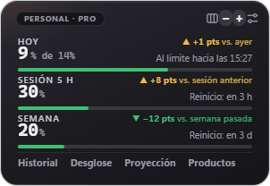

> **Unofficial** project. Not affiliated with Anthropic. "Claude" is a trademark of Anthropic.
>
> Formerly called **Cupo**. If you already had it installed, updating keeps your settings, accounts and history.

## What is it for?

Claude plans (Pro, Max, Team…) have limits: a **5-hour session**, a **weekly quota** and, on the Max plan, per-model windows such as **Fable**. claude.ai shows those numbers under *Settings → Usage*, but you have to go and look. Headroom keeps them **always in sight** in a corner of your screen and warns you in time.

It also helps you **spread your weekly quota over the days**: you choose how much you want to use at most per day (for example 14% of the week) and Headroom shows how much you've used today and warns you as you get close.

- **A single account:** see Today, the 5-hour session and the week at a glance, with alerts, history and projection. If you use Claude Code on that same computer, you also see how much of its **context window** each chat has used.
- **Several accounts** (for example personal and work, or accounts on different plans): see **all of them at once**, each with its plan, its bars, its own limits and its own history, together in one window or **each in its own window**. Alerts say which account they're about.

## Examples

The screenshots use **simulated data** (10 days of made-up usage), to show everything it can do.

### The card

**Today, the 5-hour session and the week**, each with its big number, its bar and how you're doing against yesterday, the previous session or last week at this same point (in points: ▲ +8 pts = 8 points more). The tabs at the bottom open each panel; at the top right, the layout, less or more information (− +) and Settings.


**History as line charts.** Today hour by hour, and the last 7 or 30 days, with your limit marked:

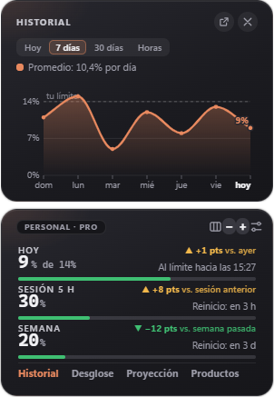

**When you use it most.** The average for each hour of the day, with your peak hour. Panels grow by dragging their edges:

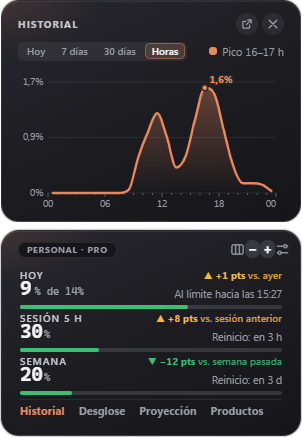

**Usage by product over time.** How much Claude Code, Chats, Cowork and Other used: the last 24 hours, this week (running total since your week started), 30 days or week by week. The last stretch is dashed, because today or the current week isn't over yet:

| This week | Week by week |
| --- | --- |
| 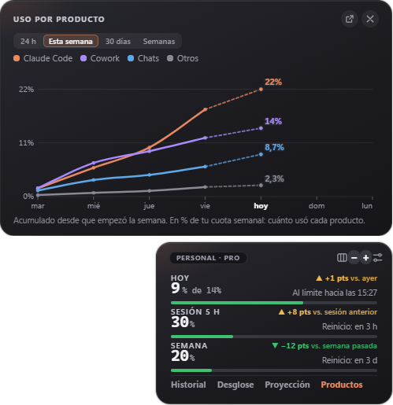 | 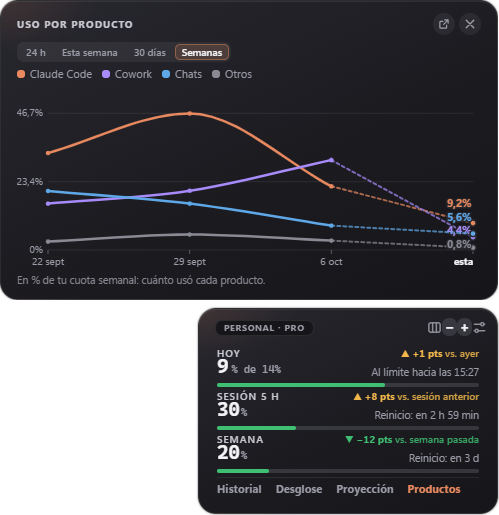 |

**Numbers only.** If you don't want the bars, hide them and the card gets shorter:

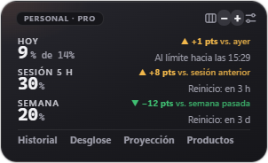

### Any size you like

The **−** and **+** buttons move from one view to the next, from less to more information: **Minimal → Compact → Normal → Dashboard**.

| Minimal | Compact |
| --- | --- |
|  | 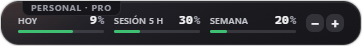 |

**Minimal** is a circle with two rings (the week outside, the 5-hour session inside). Hover over it and the compact view peeks out. In **compact**, clicking each number opens its panel.

**Normal** can be vertical (the card above) or **horizontal**:

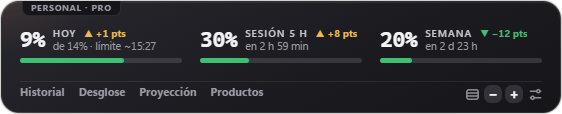

### The dashboard

**Everything at once, organized by questions:** How am I doing right now? (pace, what's left today, today's sessions, when you started), How is the week going? (against last week day by day, where you'd end up, by product), When and how do I use Claude? (day-and-hour map, by weekday, your typical day, streaks) and How is my year going?

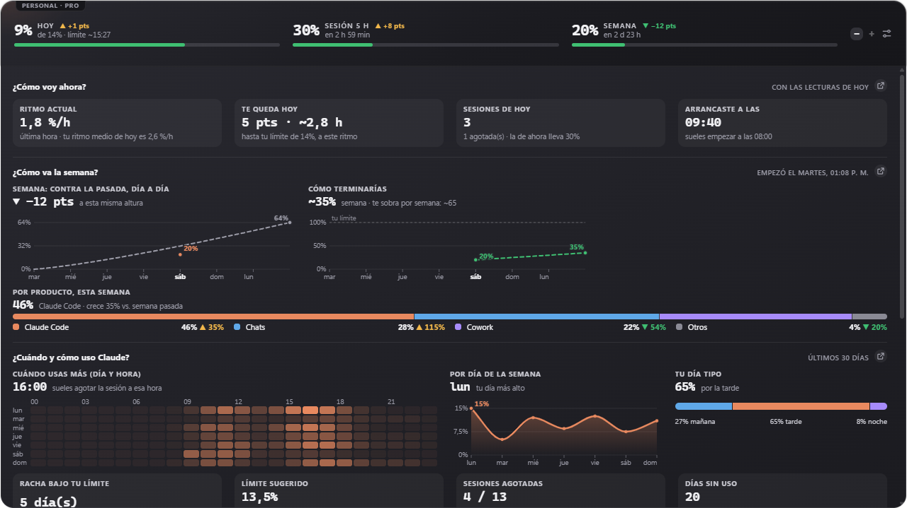

**Each dashboard question in its own window.** The button next to its title pops it out into a floating window; its X sends it back:

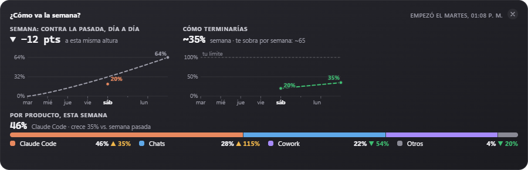

The same goes for the history, breakdown, projection, usage by product and the Claude Code context window: each can be popped out and placed wherever you like. Windows never cover each other.

### With several accounts

**All at once**, each with its plan and bars (plus Fable and extra usage, if it has them). You can have **as many accounts as you want**:

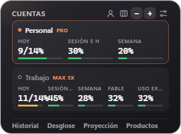

**On the dashboard**, pills at the top choose which account to see, or **All** to see them together. **Fable** is shown as big as the other bars, with its own comparison against last week:

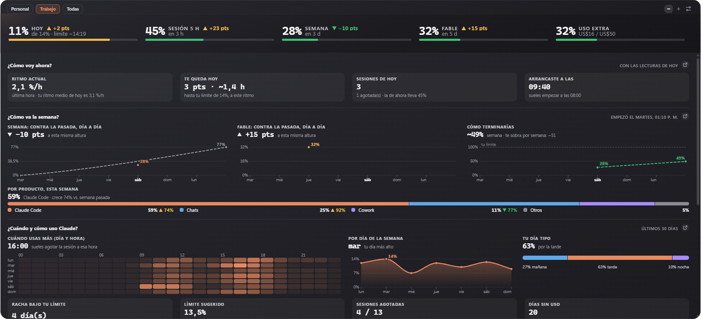

**Or each account in its own window** (in Settings), to move each one separately.

## Features

### What it shows
- **Today:** what you've used today against a **daily limit you set** (it can be different for each weekday), or an **automatic limit** that spreads what's left of your week over the remaining days. If you only care about the session and the week, **Today can be hidden**.
- **5-hour session** and **weekly quota**, with their percentage and **how long until they reset** ("in 2 h 15 min"), or the exact time if you prefer.
- **Max plan:** also the weekly **Fable** window (and any other per-model limits claude.ai reports), on the same level as the other bars. It doesn't appear on Pro.
- **Extra usage:** if you have extra credit turned on with a monthly cap, how much you've spent (for example US$16 / US$50).
- **Plan type** of each account (Pro, Max 5x, Team…).
- **Comparisons, always in points:** Today against yesterday at this time, the session against the previous one, and the week and Fable against last week at this same point.
- **History** as line charts: **today** hour by hour, and the last **7 or 30 days**, with your limit marked and your daily average.
- **Busiest hours:** which hours of the day use the most quota (the average for each hour), with your peak hour.
- **Breakdown** of the week by product (Claude Code, Chats, Cowork…) and **usage by product over time**: last 24 hours, this week, 30 days or week by week. On plans with a per-model limit (**Fable**), that limit shows up as one more line.
- **Projection** for today, the 5-hour session and the week ("at this pace you'd hit your limit at 18:40", "you'd run out of the session around 16:20"). The session one also shows up when you hover over its bar.
- **The dashboard**, with what's already saved: your current pace, what's left today, your highest day, your streak under the limit, which days and hours you use most, how much you have left over each week, a suggested daily limit, how many 5-hour sessions you run out of and how your year is going. It keeps up to a year of history and, from Settings, makes a **report** to print or save as PDF.
- **Hovering over a bar** explains what it shows.
- **Numbers only** (optional): hides the bars and leaves just the data.
- **Claude Code context window:** how much of its context window each Claude Code chat you used in the last 3 hours (up to 5) has filled, so you know when to compact it. See [below](#claude-code-context-window) for when it works.
- **Icon next to the clock** that turns green, yellow or red based on today's usage.

### Alerts (Windows notifications)
- When you get close to and reach your **daily limit**.
- 5-hour session: when it reaches the percentage you choose, when it runs out, when it resets, and when **at this pace you'd run out of session** before the reset.
- High **weekly quota** (85% by default), once a week, and when **at this pace you'd use up the week** before the reset.
- **Compact a Claude Code chat** when it reaches the percentage you choose (70% by default), and again every further 10%. If several chats get there at once, you get **a single alert** listing them all.
- **Summary** of yesterday (when the day starts) and of your week (when it resets).
- **Do not disturb:** silences alerts for 1 hour or until tomorrow from the tray menu.
- **One-click update** when there's a new version: it downloads, installs and reopens itself.

### Views and look
- **Four sizes**, from less to more information, with the − and + buttons: **Minimal** (a circle), **Compact** (one line with the three numbers and their small bars), **Normal** (the card, vertical or horizontal, with tabs for each panel) and **Dashboard** (everything, organized by questions).
- **As many accounts as you want.** With several, the card shows them together and the dashboard has pills to pick one or see them all.
- **Each account in its own window** (optional): each one moves separately and has its own view.
- **Parts in their own window:** the history, breakdown, projection, usage by product, context window and each dashboard question can be popped out into a floating window and placed wherever you like. With several accounts, each says which account it belongs to.
- **Windows don't cover each other:** if you drop one on top of another, it moves beside it and snaps to the edges. Only Settings can stay on top while it's open.
- **Resizable windows and panels:** drag the edges of the widget, an open panel or a popped-out part to resize it; text doesn't change size and each one remembers its own size (double-click an edge to go back to the original size).
- Light, dark or automatic theme, transparency, scale from 70% to 160% and **custom colors** (accent and bar colors).
- **Keyboard shortcut** Ctrl + Alt + C to show or hide it from any program.
- **Show only while Claude is open** (optional): the widget appears when you open the Claude app or Claude Code on that computer, and hides when you close it.
- Export the history to **CSV** (opens in Excel).
- **Backup:** save your settings, accounts and history to a file, and restore them on another computer or after reinstalling Windows. (The backup doesn't include your sign-ins: you sign in to each account again.)

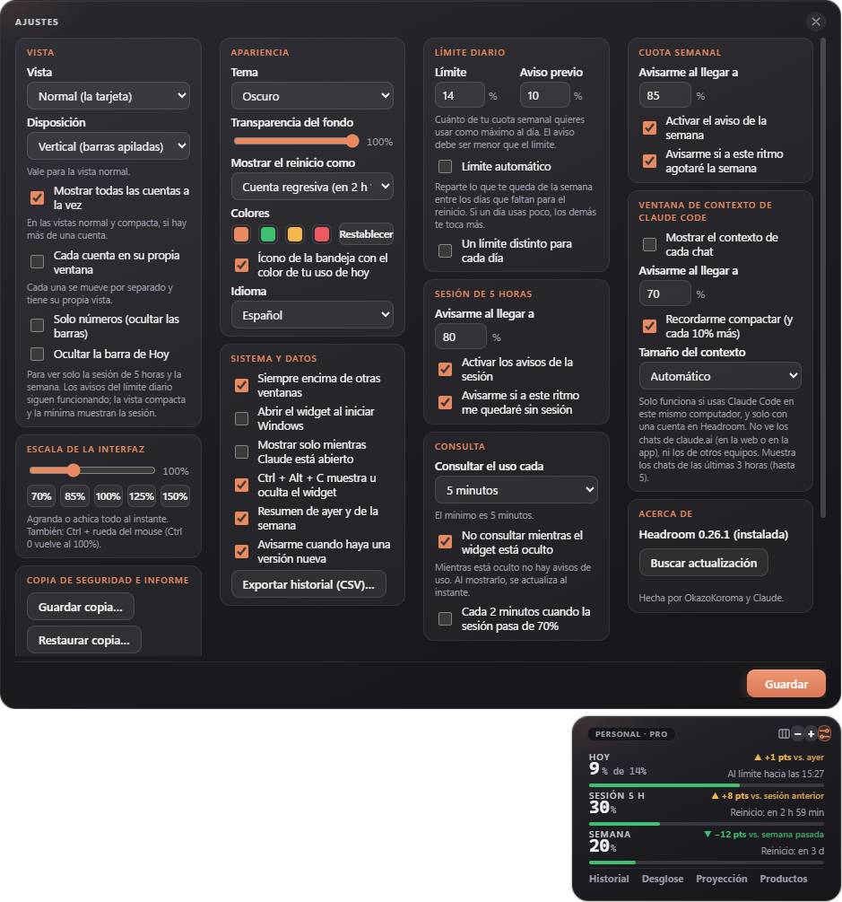

## Claude Code context window

Each Claude Code chat has a "memory" (the context window). When it fills up, the chat gets summarized automatically or you have to start a new one. Headroom shows how full each chat is and reminds you to type `/compact` before it fills up.

- **It only works with Claude Code used on that same computer:** Headroom reads the files where Claude Code stores its chats (`%USERPROFILE%\.claude\projects`). It only looks at the chat's name and how many tokens it has used.
- **It can't see claude.ai chats** (on the web or in the app), because claude.ai doesn't report how much context each conversation uses. It can't see chats from other computers either.
- **It only appears with one account in Headroom.** With several (usually used on different computers) it isn't useful, so it's hidden.
- If you don't use Claude Code, the section simply doesn't appear.

## Languages

Español · English · Português (Brasil) · Français · Deutsch, or **automatic** (the Windows language). Change it in Settings and everything switches instantly: the window, the menu, the alerts and the CSV (with each language's decimal comma or point).

## Install

1. Download `Headroom-Setup-x.y.z.exe` from the [Releases](../../releases) section.
2. Run it. It installs by itself, no administrator rights needed.
3. Windows may show a blue **SmartScreen** warning ("Windows protected your PC") because the installer isn't signed with a paid certificate. Click *More info → Run anyway*. If you'd rather not trust it, all the code is here and you can [build it yourself](#build-it-yourself).
4. The first time, a short welcome explains what everything is. Click **Sign in** and log in to claude.ai as usual.

**To add another account:** click the label with the account name (top left), or the icon next to the clock → Account → **Add account…**. Type a name to recognize it (for example, Work), click **Add** and sign in to claude.ai with that account in the window that opens.

For now there is only a **Windows** version (10 and 11).

## How it works (and what data it touches)

Anthropic doesn't offer an official way to query plan usage, so Headroom does what your browser does: it opens claude.ai in an invisible window **with your own session** and reads the same numbers shown on the *Settings → Usage* page. **It doesn't use up your quota:** it never sends messages to Claude.

- **Your password never goes through Headroom.** Signing in happens on the real claude.ai page.
- Each account keeps its session on your computer, in its own space. Headroom only checks whether the session cookie exists (yes / no); it doesn't read or copy it.
- The only data it saves is your settings and the daily usage percentages, in a local file (`%APPDATA%\widget-uso-claude\datos.json`).
- **Checks every 5 minutes** by default (you can choose 5 to 60; never less than 5, so as not to bother claude.ai). Optionally, **every 2 minutes only while the 5-hour session is above 70%**, which is when timely alerts matter. **While the widget is hidden it doesn't check at all**; when you show it, it updates right away (can be changed in Settings).
- No servers, no accounts, no telemetry. What goes out to the internet: the requests to claude.ai and, once a day, a request to GitHub to check for a new version (can be turned off in Settings). The Claude Code context window only reads files on your computer.

## Honest limitations

- **It can stop working without notice.** It depends on how the claude.ai page is built; if Anthropic changes it, the widget may stop reading usage. Headroom detects this and tells you; the fix lives in a single file (`src/uso.js`).
- "Today's usage" is computed by Headroom: the difference between the current weekly percentage and the one at the start of the day (midnight in your time zone).
- Headroom doesn't count tokens or messages: it shows the percentages that claude.ai reports.
- Make sure your use of this tool is in line with Claude's terms of service. Use at your own risk.

## Build it yourself

You need [Node.js](https://nodejs.org) (version 20 or newer).

```bash
npm install
npm start          # opens the widget
npm test           # tests for the calculations, the context window and the languages
npm run dist       # builds the installer into the dist folder
```

## Layout

```
src/main.js            startup, window, tray, accounts, alerts
src/sesion.js          sign-in (one session per account)
src/uso.js             reads usage from claude.ai  ← the only part that depends on their page
src/calculo.js         daily maths, alerts, projections (no Electron: easy to test)
src/almacen.js         saved data (JSON)
src/actualizaciones.js new version and one-click update (GitHub)
src/contexto.js        context window of Claude Code chats (local files)
src/idiomas/           the texts, one file per language
src/ventanas/          the widget screen (HTML, CSS and JS)
pruebas/               automated tests (npm test)
```

**Adding a language:** copy `src/idiomas/es.js`, translate it and register it in `src/idiomas.js`.

## Contributing

Ideas, bug reports and improvements are welcome: open an issue or a pull request. If the widget stopped reading your usage, an issue with the error message is the most useful thing.

## License

[MIT](LICENSE)
